<picture><source media="(prefers-color-scheme: dark)" srcset="assets/dark/header-v1.svg"/></picture>

<a href="https://github.com/hibikazen/ai-bug-bounty-hunter"><picture><source media="(prefers-color-scheme: dark)" srcset="https://img.shields.io/badge/STARTER_KIT-0d1117?style=flat-square"/></picture></a>
<a href="https://github.com/hibikazen/smart-contract-attack-patterns"><picture><source media="(prefers-color-scheme: dark)" srcset="https://img.shields.io/badge/ATTACK_PATTERNS-0d1117?style=flat-square"/></picture></a>
<a href="https://github.com/hibikazen/web3-bug-bounty-programs"><picture><source media="(prefers-color-scheme: dark)" srcset="https://img.shields.io/badge/BOUNTY_PROGRAMS-0d1117?style=flat-square"/></picture></a>
<a href="https://github.com/hibikazen/bounty-poc-kit"><picture><source media="(prefers-color-scheme: dark)" srcset="https://img.shields.io/badge/POC_KIT-0d1117?style=flat-square"/></picture></a>

<picture><source media="(prefers-color-scheme: dark)" srcset="assets/dark/s01.svg"/></picture>
<picture><source media="(prefers-color-scheme: dark)" srcset="assets/dark/whoami.svg"/></picture>
<picture><source media="(prefers-color-scheme: dark)" srcset="assets/dark/s02.svg"/></picture>
<picture><source media="(prefers-color-scheme: dark)" srcset="assets/dark/ecosystem.svg"/></picture>
<picture><source media="(prefers-color-scheme: dark)" srcset="assets/dark/s03.svg"/></picture>
<picture><source media="(prefers-color-scheme: dark)" srcset="assets/dark/projects.svg"/></picture>

live — <a href="https://hibikazen.github.io/makefun-gta6-01/game/">Sunset Bay</a> · <a href="https://hibikazen.github.io/makefun-gta6-trophy-guide-01/app/">Leonida Platinum</a> · <a href="https://hibikazen.github.io/makefun-gta6-cover-art-01/app/">Sunset Cover Studio</a> · <a href="https://hibikazen.github.io/makefun-token-radar-01/dashboard/">Token Radar</a>

<picture><source media="(prefers-color-scheme: dark)" srcset="assets/dark/s04.svg"/></picture>

<picture><source media="(prefers-color-scheme: dark)" srcset="https://github-readme-stats.vercel.app/api?username=hibikazen&amp;show_icons=true&amp;hide_border=true&amp;bg_color=00000000&amp;title_color=ffffff&amp;text_color=ffffff&amp;icon_color=ffffff&amp;custom_title=Hibikazen%27s%20GitHub%20Stats"/></picture>
<picture><source media="(prefers-color-scheme: dark)" srcset="https://github-readme-stats.vercel.app/api/top-langs/?username=hibikazen&amp;layout=compact&amp;hide_border=true&amp;bg_color=00000000&amp;title_color=ffffff&amp;text_color=ffffff"/></picture>

<picture><source media="(prefers-color-scheme: dark)" srcset="https://github-readme-activity-graph.vercel.app/graph?username=hibikazen&amp;bg_color=00000000&amp;color=ffffff&amp;line=ffffff&amp;point=ffffff&amp;area_color=ffffff&amp;area=true&amp;hide_border=true&amp;radius=0&amp;custom_title=CONTRIBUTION%20TELEMETRY"/></picture>

<picture><source media="(prefers-color-scheme: dark)" srcset="assets/dark/s05.svg"/></picture>
<picture><source media="(prefers-color-scheme: dark)" srcset="assets/dark/timeline.svg"/></picture>
<picture><source media="(prefers-color-scheme: dark)" srcset="assets/dark/s06.svg"/></picture>
<picture><source media="(prefers-color-scheme: dark)" srcset="assets/dark/stack.svg"/></picture>
<picture><source media="(prefers-color-scheme: dark)" srcset="assets/dark/footer.svg"/></picture>

<!-- one responsive picture per visual; light and dark variants switch by color scheme -->
